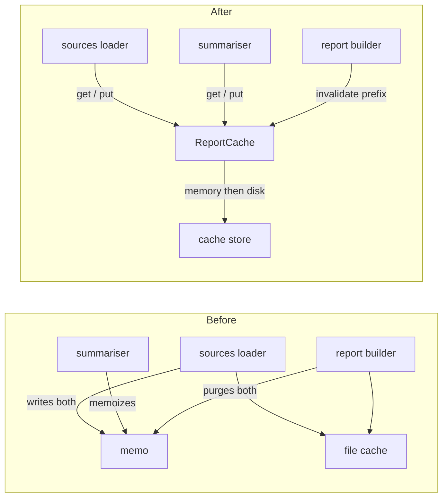

# One report cache with an explicit TTL, no scattered invalidation

Status: approved · Ticket: RG-42

## Problem

Reportgen serves stale summaries after fresh source reads, and a fresh run throws away rows that were seconds old; nobody can say how long a cached value is
valid, because nothing decides it. Done means one cache, one place that decides validity, and every existing test green.

## Diagnosis

Every source read goes through two caches that know nothing about each other: an in-process memo keyed by free-form strings and an on-disk file cache. Each
caller keeps them in sync by hand — the sources loader writes both and drops the summary memo whenever it loads; the report builder empties both by reaching
into each module on a fresh run; the summary module memoizes under a key the loader also knows about. No store carries a time-to-live, so validity is decided by
whichever caller last touched the keys.

## Approach

Put one ReportCache in front of every read. It keeps memory in front of disk internally, takes a time-to-live per entry, and offers a single invalidation entry
point by key prefix. The loader, the summariser and the report builder receive the cache as a collaborator and stop touching memo or file storage directly; a
fresh run invalidates by prefix instead of purging two stores.

- Keep both caches and document the sync rules — rejected. The rules already exist as comments and are already broken in three places; documentation does not
  stop the fourth caller from adding a fourth rule. It would only become right if the two stores had genuinely different lifecycles, which they do not.
- One store only, in memory, persisted at exit — rejected. It loses the cross-run reuse the file cache exists for, and persisting a memo on exit is the same
  two-store problem moved to shutdown.

## Decisions

- One cache class owns key naming, not the callers — rejected caller-owned keys because prefix invalidation needs consistent names.
- Memory sits in front of disk inside the cache, not as two caches the caller chooses between — rejected caller choice because that is today's problem.
- Invalidation is by key prefix, not by enumerating keys — rejected enumeration because callers would need to know every key class.

## Architecture

What replaces what?



- **ReportCache** (new) — the only cache: a memory tier in front of a disk tier. Owns key naming, validity and invalidation.
- **sources loader** (changed) — asks the cache for rows and reads the data file on a miss. No longer drops anyone else's keys.
- **summariser** (changed) — asks the cache for the summary and computes on a miss.
- **report builder** (changed) — a fresh run invalidates by prefix; it no longer reaches into any store.
- **Removed** — the memo module, the file cache as a public collaborator, the loader's forget function.

## Logic

**Validity** — in ReportCache. Every entry carries its expiry; nothing else decides whether a value may be served.

```
get(key):
  memory has it and not expired        → value
  disk has it and not expired          → copy to memory, value
  expired in either tier               → drop from both, none
put(key, value, ttl):  store in memory and on disk with expiry = now + ttl
invalidate(prefix):    drop every key starting with prefix from both tiers
```

**Fresh runs and dependent values** — in the report builder and the loader. A fresh run invalidates the source and the summary prefixes before building. A
summary is never served over newer rows: the summary TTL is not longer than the source TTL, and a source re-read invalidates that source's summary.

## Contracts

```python
class ReportCache:
    """One cache for sources and summaries. Memory in front of disk; one TTL per entry; one invalidation entry point."""

    def get(self, key: str) -> object | None:
        """Value if present and not expired, else None. Expired entries are dropped on read."""

    def put(self, key: str, value: object, ttl_seconds: float) -> None:
        """Stores in memory and on disk. ttl_seconds <= 0 raises ValueError."""

    def invalidate(self, prefix: str = "") -> int:
        """Drops every key starting with prefix from both tiers; returns the count."""
```

```python
# each gains the cache as a collaborator
def load_source(name: str, cache: ReportCache) -> list[dict]: ...
def summarize(name: str, cache: ReportCache) -> dict: ...
def build_report(names: list[str], cache: ReportCache, fresh: bool = False) -> str: ...
```

Dependency rule: no module but ReportCache imports the storage it sits on.

## Consequences

- The memo was process-wide; the cache is a collaborator. A caller that constructs its own ReportCache silently gets its own memory tier, so the CLI builds one
  and passes it down.
- A restart within the source TTL now serves sources from disk without a data read; before, the memo was lost and the file cache decided alone.
- Two processes sharing the disk tier are not coordinated.
- Unchanged: report output, CLI flags, the JSON source format, and what the three existing tests assert — their wiring may be re-pointed at the new cache, their
  assertions may not.

## Open questions

- Does `--fresh` clear the disk tier too, or only memory? Contracts say both. — the project owner; blocks the report-builder milestone.
