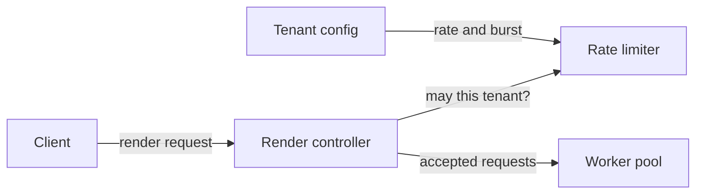

# Example design — a feature in an existing codebase

A new capability added to a running service: where it sits, the decisions, the rule that gets built, the surface it adds and what it costs. Every fact appears
once.

---

# Per-tenant rate limiting on the report API

Status: approved · Ticket: RS-118

## Problem

One tenant's nightly export bursts several thousand render requests into the report API within a minute, and every other tenant's requests wait until the burst
drains. Support has handled this by phone twice this quarter. Done means a tenant that exceeds its allowed rate is told so immediately with a retry hint, and no
tenant under its rate waits on another tenant's burst.

## Diagnosis

The service has no notion of a tenant before work starts: requests are accepted in arrival order into a fixed worker pool, so the first client to arrive in
volume owns the pool until its requests drain, and nothing between the edge and the pool can say no. Fairness cannot be added inside the pool without a
scheduler; it has to be decided before a request is accepted, per tenant, with a bound on bursts as well as on sustained rate.

## Approach

Limit each tenant to a sustained rate with a bounded burst, decided at the API edge before a request reaches the worker pool, using a token bucket per tenant:
tokens refill at the tenant's rate up to a burst capacity, each request spends one, and a request that finds no token is rejected with a retry hint. Limits come
from tenant configuration with a default.

- Fixed window per tenant (N requests per minute) — rejected. A client can spend a full window's allowance in the last second and the next window's in the
  first, so a two-second burst of twice the limit passes; the complaint that started this would not be fixed.
- Fair queueing inside the worker pool — rejected. It fixes fairness but not overload: the burst is still accepted and still occupies memory and connections;
  and it needs a scheduler where a limiter needs a counter. It would become right if we had to guarantee throughput per tenant rather than bound it.

## Decisions

- One bucket per tenant per instance, not shared across instances — a shared bucket needs a shared store and is its own design. The accepted cost: a tenant's
  effective limit is the per-instance limit times the instance count.
- Reject with 429 and a Retry-After header rather than delaying the request — delaying holds a connection and hides the overload from the client.
- Limit per tenant, not per API key — a tenant with many keys would otherwise multiply its allowance.
- Limits live in tenant configuration with a service-wide default — a global limit alone can't give the enterprise tenant its contracted rate.

## Architecture

Where is a request stopped, and who decides?



- **Rate limiter** (new) — holds one bucket per tenant and answers allow, or deny with the wait until the next token. Knows nothing about HTTP.
- **Render controller** (changed) — asks the limiter before queueing a render and turns a deny into the 429 response.
- **Tenant config** (changed) — gains the rate and burst fields with defaults.
- **Worker pool** — unchanged; it never sees a rejected request.

## Logic

**Taking a token** — in the rate limiter. The bucket computes what it would have refilled since it was last touched, so there are no timers, no background
thread, and constant work per request.

```
take(tenant, now):
  b = buckets[tenant] or new bucket(tokens = burst, touched = now)
  b.tokens = min(burst, b.tokens + (now - b.touched) * rate)
  b.touched = now
  if b.tokens >= 1: b.tokens -= 1; return allow
  return deny(wait = (1 - b.tokens) / rate)
```

A tenant without a configured limit gets the service-wide default.

## Contracts

```java
public interface RateLimiter {
   /** Consumes one token for the tenant. Returns ALLOW, or DENY carrying the seconds until a token is available.
       Never blocks; unknown tenants get the default limit. */
   Decision take(TenantId tenant);
}

public record Decision(boolean allowed, Duration retryAfter) {}
```

```
POST /reports/{name}/render
  → 202 { "jobId": "…" }                      unchanged
  → 429, header Retry-After: <seconds>,       new: tenant over its rate
       body { "error": "rate_limited", "retryAfterSeconds": n }
```

```
tenant configuration (per tenant, defaults service-wide):
  rateLimit.requestsPerSecond   default 20
  rateLimit.burst               default 100
```

Dependency rule: the rate limiter depends on neither the HTTP layer nor the render handler; the controller depends on it.

## Consequences

- A limit set too low on the enterprise tenant looks like an outage to them. The limiter ships with no limit as the default and is enabled per tenant, after
  support has reviewed the first values.
- Buckets live in memory: after a restart every tenant's bucket is full, so a burst right after a deploy is accepted.
- Tenants are not prioritised against each other under overload; every tenant is bounded, none is favoured.
- Unchanged: the 202 response, the job queue and the worker pool.

## Open questions

- Should the 429 body carry the tenant's configured rate so clients can self-tune? — product owner; blocks the controller change.
