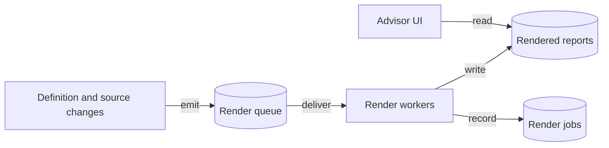
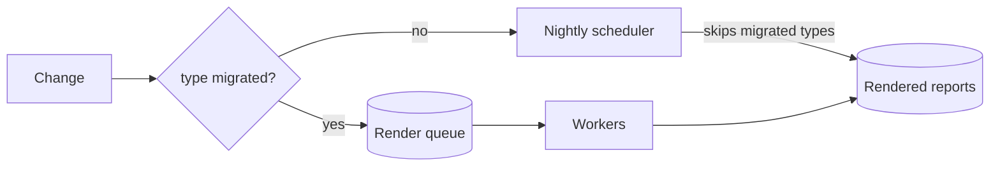

# Example design — an initiative

A legacy nightly scheduler replaced by an event-driven render pipeline, one report type at a time: the target architecture, the coexistence mechanism as the
logic, the shared contracts, and what holds while slices land. Its roadmap is `../../writing-roadmap/references/example-roadmap.md`; slices get their own
designs that link this one.

---

# Event-driven report rendering, replacing the nightly scheduler

Status: approved · Ticket: RS-140 · ADR: `<date>-adr-render-on-change-not-on-schedule.md`

## Problem

A report changed at 9 a.m. is not visible until the next morning, a failure halfway through the night leaves half the catalogue stale, and "re-run the night" is
the most common support ticket in the service. Done means a report is re-rendered within minutes of a change to its definition or its sources, the nightly job
is gone, and a failed render affects only that report.

## Diagnosis

Rendering is coupled to a schedule rather than to change: a nightly job walks every report definition and renders each synchronously whether or not anything
changed, so latency is the schedule's period, cost grows with the catalogue, and one failure is everyone's failure because the run is a single sequence. Nothing
in the system knows when a report's inputs changed; that knowledge exists only in the definition service and the source adapters, and they never say so.

## Approach

Render on change, not on schedule. A change to a report definition or to a source emits a render request; a queue holds the requests; workers render them
independently and retry on failure. The scheduler keeps rendering whatever has not yet moved, type by type, until nothing is left and it is deleted. Rationale
in the ADR above.

- Speed up the nightly job by rendering in parallel — rejected. It keeps every report on a nightly cadence and keeps the all-or-nothing run; parallelism
  shortens the window without fixing the model.
- Incremental nightly job that renders only changed reports — rejected. It fixes the wasted work but not the latency, and the change detection it needs is the
  same event we would emit anyway; having emitted it, rendering immediately is the smaller step. It would become right if rendering had to be batched for a
  downstream consumer.

## Decisions

- Routing between old and new is by report type, not by report — a type is the unit the scheduler already iterates, so the split needs no new bookkeeping in the
  legacy path.
- Delivery is at-least-once with idempotent renders keyed by report and source version — rejected exactly-once because it needs a transactional outbox the
  sources don't share, while a duplicate render is harmless.
- A type is rendered by exactly one path at a time — rejected running both in parallel for a comparison period, because two writers to the rendered-reports
  store would need a reconciliation the scheduler cannot do.

## Architecture

What does the end state look like?



How do old and new coexist while types migrate?



- **Render queue** (new) — holds render requests and dead-letters them after the retry budget.
- **Render workers** (new) — render one request at a time and record a render job per request.
- **Change emitters** (changed) — the definition service and each source adapter emit a render request on change, for migrated types only.
- **Nightly scheduler** (changed, then removed) — skips migrated types; deleted by the last slice together with the routing table. It gains no new dependency in
  any slice.
- **Routing table** (new, temporary) — the set of migrated report types, in configuration; the one thing emitters and scheduler both read.

## Logic

**Coexistence** — in the routing table, read by emitters and scheduler. A report type is rendered by exactly one path at any time.

```
on a change to a report:     type migrated → emit a render request      else → nothing; the night picks it up
nightly run, per type:       type migrated → skip                       else → render as today
migrate a type:              ship its emitters, then add it to the routing table
revert a type:               remove it from the routing table; the next night renders it again
```

Rendered reports are one store written by either path, so no state is duplicated; render jobs exist only for the queue path.

**Superseded requests** — in the render workers. A request carries the source versions that triggered it.

```
on delivery:
  request's source versions older than the report's last render → skip
  otherwise render, keyed by report and source versions        → a second delivery of the same request rewrites the same output
```

## Contracts

```
RenderRequest  { reportId, reportType, sourceVersions: map<sourceId, version>, requestedAt }
                emitted by definition and source adapters; consumed by workers
RenderJob      { jobId, reportId, sourceVersions, state: queued | rendering | done | failed, attempts }
                one per request; state transitions only forward except failed → queued on retry
```

```java
public interface RenderQueue {
   /** Enqueues for at-least-once delivery. Returns the job id; never blocks the emitter. */
   JobId enqueue(RenderRequest request);
}

public interface RoutingTable {
   /** True when the type is rendered by the queue; the scheduler must then skip it. Read from configuration; a missing type is not migrated. */
   boolean isMigrated(ReportType type);
}
```

Dependency rules: emitters and workers depend on the queue interface, never on each other or on the scheduler; no module reads the routing configuration key
except through the routing table.

## Consequences

- Types can migrate in any order and one at a time; the roadmap is free to choose. The one ordering that matters is inside a migration: emitters ship before the
  routing table changes, or changes to that type are rendered by nobody until the entry is reverted.
- Until its slice lands, an unmigrated type behaves exactly as today, next-morning latency included.
- The two source adapters without change detection get a periodic version check of their own. If that check is expensive, their types are the long tail and stay
  on the scheduler longest.
- Renders can happen twice. That is accepted everywhere a render is cheap; a type where it is not needs its own decision in its slice.
- Unchanged throughout: the rendered report format and the location advisors read from.
- Not part of this: rendering priority between tenants, and retention of render jobs beyond debugging needs.

## Open questions

- Retry budget and dead-letter handling — operations; blocks the first slice's design.
- Is the render job store the same database as the reports? — operations; blocks the first slice's design.
