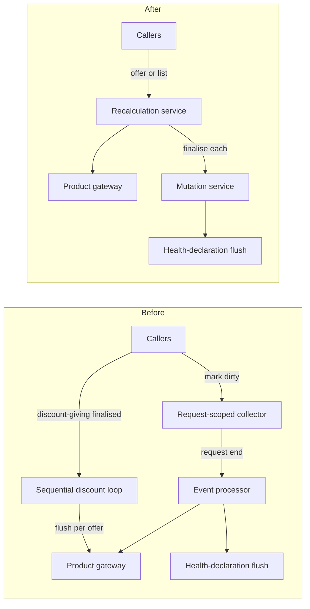

# Example design — a replacement in an existing codebase

Two overlapping mechanisms become one explicit service: what replaces what, the decisions, the batch rule that gets built, the new surface and what it costs.
Its plan is `../../writing-plans/references/example-plan-replacement.md`; together the two are complete, and nothing is said twice.

---

# One explicit product-recalculation service, no request-scoped deferral

Status: approved · Ticket: <id> · ADR: `<date>-adr-business-process-state-outside-technical-lifecycle-scope.md`

## Problem

When an offer changes, its products must be recalculated; when the discount-giving offer of a family changes, every discount-receiving offer must be
recalculated too. Recalculation is slow where it should be batched, hidden where callers need to reason about it, and cannot be parallelised where it must be —
and every new caller adds another way to get it wrong. Done means every caller reaches recalculation through one service, the collector and the sequential loop
are gone, and every existing scenario is green.

## Diagnosis

Two overlapping mechanisms do one job. One defers: callers mark offers dirty in a request-scoped collector and the set is recalculated when the request ends.
The other is immediate and sequential: finalising a discount-giving offer loops over its dependents and recalculates and flushes each on its own. The deferral
almost never batches — only two flows ever mark more than one offer — the main command path bypasses it entirely, and the sequential loop cannot be parallelised
because each iteration flushes inside the request. Neither mechanism does what its name promises, and the request lifecycle, not the caller, decides when work
happens.

## Approach

Replace both with one explicit, stateless domain service, ProduktRecalculationService, offering two operations: recalculate one already-loaded offer in memory,
or recalculate an explicit list of offers as a batch that may compute in parallel. Batch callers name their offers instead of draining hidden request state.
This design instantiates the rule recorded in the ADR above.

- Keep the deferral and route the discount loop through it — rejected. Its batching never materialises, since only two flows ever mark more than one offer, and
  it keeps the flush point hidden in request state. It would only become right if most callers genuinely batched, which none do.
- Fix the sequential loop's parallelism in place — rejected. The per-item flush inside the loop is exactly what causes the transaction clash, so parallelising
  it needs the in-memory / finalise split anyway; at that point it is the new service under another name.

## Decisions

- The batch operation takes an explicit list of offer numbers, not a query by family — rejected the query because callers already hold the list and a query
  would hide a second read path.
- Discount-giving offers are recalculated first inside the batch, not by the caller — rejected caller ordering because every caller would repeat it.
- The health-declaration flush stays synchronous at finalise — the lazy variant is an earlier, unimplemented ADR and out of scope here.

## Architecture

What replaces what?



- **Recalculation service** (new, `ProduktRecalculationService`) — the only entry point for product recalculation, and the only caller of the product gateway
  for it. Stateless; holds nothing between calls.
- **Mutation service** (changed) — finalise flushes health declarations directly. It does not know the recalculation service; the dependency runs the other way.
- **Roles service** (changed) — on a discount-giving finalise it computes the dependent offers and hands the list to the batch. Its own loop is gone.
- **Callers** (changed) — hand the service one loaded offer or an explicit list. Nobody marks anything dirty any more.
- **Removed** — the request-scoped collector and its service, the event processor, the sequential loop.

## Logic

**The batch** — in the recalculation service. Discount-giving offers go first because their result is the input of the receiving ones; the three phases keep
every database access on the main thread, which is what makes the middle one safe to parallelise.

```
recalculate(offers, editor):
  unknown offer number              → fail the whole batch before anything is recalculated
  mark each offer's health declaration dirty
  giving, receiving = split by discount role
  giving: recalculate one by one
  receiving, in three phases:
    read all                          main thread
    compute in memory                 worker threads, no persistence
    reconcile and finalise with editor  main thread, offer by offer
```

**Fan-out runs one way** — in the roles service. A changed discount-giving offer recalculates its receivers; a changed receiver recalculates only itself.

## Contracts

```java
@DomainService @Dependent @Transactional
public class ProduktRecalculationService {

   /** One already-loaded offer, recalculated in memory on that instance. No reload, no flush. A gateway failure propagates and leaves the offer unmodified. */
   public void recalculate(Angebot angebot, ProduktCalculationContext context);

   /** Explicit batch, as under Logic; finalises every offer with the given editor. Empty list: no-op. */
   public void recalculateAngebote(List<AngebotNr> angebotNrn, Bearbeiter bearbeiter);
}
```

Dependency rule: callers reach the product gateway for recalculation only through the recalculation service.

## Consequences

- The discount path has never run in parallel in production. The three-phase split makes it safe in theory; the suite has to prove it.
- Callers must now know when they hold a batch. Nothing quietly merges marks any more, so a caller that recalculates offers one by one pays for each.
- Caching in the discount-giving lookup is not part of this; it is a recorded follow-up.
- Unchanged: premiums and roles in the family-discount, copy, person-data and partner-data flows; health-declaration dirty marking and the customer-advisor
  gate.

## Open questions

- Should a batch skip an unknown offer number instead of failing as a whole? — domain owner; needed before the first caller moves to the service.
